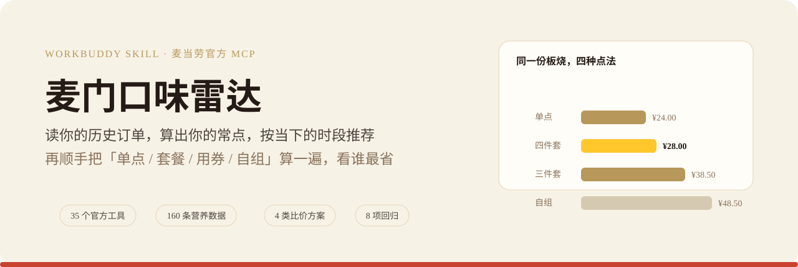
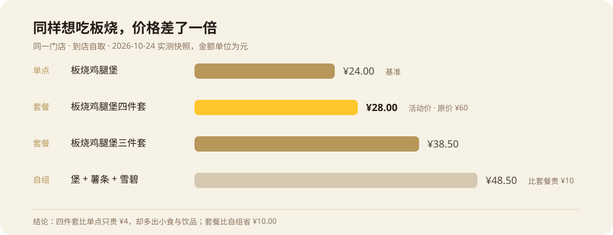
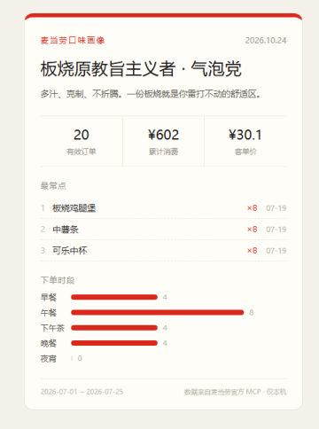

     

**你常吃的那几样，和你今天最省的点法。**

一句话说需求 → 读历史订单 → 按当下时段推荐 → 算清「单点 / 套餐 / 用券 / 自组」谁最省。

**不绑定任何一家客户端**：支持 MCP 的 Agent 直接调工具，不支持的 Agent 用一条命令跑完。

[先看效果](#先看效果) · [真实案例](#真实案例) · [安装使用](#安装使用) · [任何 Agent 都能用](#任何-agent-都能用) · [如何工作](#如何工作) · [验证记录](#验证记录) · [欢迎与支持](#欢迎与支持)

## 先看效果

同一家门店、同一个目标，四种点法能差出一倍：



这是 2026-10-24 的一次真实查询（到店自取，价格是当日快照）。最有意思的不是哪份最便宜，而是 **四件套 ¥28 比三件套 ¥38.50 还便宜**——因为它在做活动价（原价 ¥60）。这种信息任何推荐列表都不会主动告诉你。

偏好侧长这样（示例数据，非真实账户）：



卡面在样本不足时会自己写「人格为暂定」，不会硬装懂你。

## 真实案例

> 现在几点，我想吃板烧，哪家店能买、怎么点最省？

它会查历史订单里的常点项、拉当前门店的在售菜单、把券包解析成「此刻能不能用」，然后给出四类方案的对比：

| 方案 | 组成 | 价格 | 说明 |
|---|---|---|---|
| 单点 | 板烧鸡腿堡 | ¥24.00 | 基准，391 kcal |
| 套餐 | 板烧鸡腿堡四件套 | **¥28.00** | 活动价，原价 ¥60.00 |
| 套餐 | 板烧鸡腿堡三件套 | ¥38.50 | 含小食与饮品 |
| 自组 | 堡 + 薯条 + 雪碧 | ¥48.50 | 比套餐贵 ¥10.00，785 kcal |

结论三条：只要主品 ¥24；想吃一套走四件套 ¥28，**只比单点多 ¥4 就多出小食和饮品**；同样吃「堡+薯+饮」，套餐比自组省 ¥10.00。

同一次查询里，一张「11.9 元麦辣鸡腿堡」券被判定**今天用不了**——它的有效期从 10-26 才开始，且只限周一到周五。券包 md 里的有效期同时含日期、星期、时段三重限制，只看「有没有券」会直接推荐错。

| 还可以这样问 | 它会做什么 |
|---|---|
| 「我平时都点什么」 | 读订单算常点，按次数排序并标出最近一次 |
| 「早上吃什么」 | 只在早餐时段走早餐线；10:00–10:29 会提醒你还有几分钟收档 |
| 「我昨天刚吃过板烧」 | 近 7 天重复的品降权，并明说哪天吃过 |
| 「怎么点最便宜」 | 给出四类方案与差价，识别活动价，校验券能不能用 |

完整运行记录见 [examples/verified-run.md](examples/verified-run.md)。

## 安装使用

需要支持远程 MCP 的 AI 客户端（WorkBuddy / Cherry Studio / Cursor 等），以及你自己的麦当劳 MCP Token。脚本需要 Python 3.10+，只使用标准库。

1. 到[麦当劳 MCP 平台](https://open.mcd.cn/mcp)登录 → 控制台 → 激活，拿到 Token。
2. 在客户端把连接器配上（地址必须是 `https://mcp.mcd.cn`，协议 Streamable HTTP）：

```json
{
  "mcpServers": {
    "mcd-mcp": {
      "type": "streamablehttp",
      "url": "https://mcp.mcd.cn",
      "headers": { "Authorization": "Bearer YOUR_MCP_TOKEN" }
    }
  }
}
```

3. 把 `skills/mcd-favorite-picker` 整个文件夹导入你的技能目录（WorkBuddy 可在仓库根目录运行 `./install.ps1`），新开会话，然后说：

```text
用麦门口味雷达。现在几点、我想吃板烧，帮我看看常点什么、怎么点最省。
先告诉我哪家店能买，不要下单。
```

Token 只填在你自己的客户端配置里。仓库里的 [`mcp-config.example.json`](mcp-config.example.json) 只有 `${MCD_MCP_TOKEN}` 占位符。

详细步骤见 [docs/quick-start.md](docs/quick-start.md)。

## 任何 Agent 都能用

远程 MCP 不是所有 Agent 都支持。所以这个项目准备了三条路径，**没有一条需要改代码**：

| 你的 Agent | 走哪条 | 一行命令 |
|---|---|---|
| 支持远程 MCP | **直连**，按 SKILL.md 六步走 | 配好连接器即可 |
| 只能执行命令 | **一条命令跑完** | `python skills/mcd-favorite-picker/scripts/run_recommend.py --target 板烧 --city 芜湖 --keyword 步行街` |
| 需要自己编排 | **单工具直调** | `python skills/mcd-favorite-picker/scripts/mcp_client.py call order-list` |

第三条的 `mcp_client.py` 是纯标准库实现的 MCP 客户端：Streamable HTTP 传输、JSON-RPC、SSE 解析、`Mcp-Session-Id` 会话保持都做了。它存在的唯一理由是——**Agent 不支持 MCP 时，仍然能调到同一批官方接口**。

```powershell
# 连通性自检，应显示 35 tools
python skills/mcd-favorite-picker/scripts/mcp_client.py tools

# 一条命令出完整报告（不需要 AI，也不需要 MCP 客户端）
python skills/mcd-favorite-picker/scripts/run_recommend.py --store 3450024 --target 板烧 --card
```

输出三样东西：`今日推荐.md`（偏好 + 比价 + 券）、`prefs.json`（可反复累积）、`口味画像卡.html`。

Token 放环境变量 `MCD_MCP_TOKEN`、`~/.mcd_mcp_token`，或 `--token-file` 指定，三种都行。

各客户端的具体位置（WorkBuddy / Claude Code / Cursor / Cherry Studio / Cline / Codex / Zed / Aider）见 [docs/agent-compatibility.md](docs/agent-compatibility.md)；给模型看的行为约定见 [AGENTS.md](AGENTS.md)。

## 如何工作


AI 负责理解需求、调官方工具；本地脚本负责能算清楚的部分：

- **偏好来自订单**：`order-list` 每次可能只给近期几单，所以脚本按 `orderId` 去重后**增量累积**到 `prefs.json`。跑一次和跑十次得到的计数一致，不会重复计数。
- **套餐要拆开看**：`productName` 只是套餐壳名，真正吃到的汉堡和小食在 `comboItemList[].name`，统计口径以子项为准。
- **价格以菜单为准**：`query-meals` 的 `currentPrice` 已是元；`calculate-price` 返回的是分，两者不混用。
- **活动价必须识别**：`currentPrice < originalPrice` 就是促销。不识别这一条，就会错过「四件套比三件套便宜」。
- **券要四维校验**：日期区间、星期限制、每日时段窗口、适用渠道，全部通过才算可用。
- **卖不了的不推荐**：历史品名下架后（实测相似度仅 0.29）不会硬推，改为按品类 + 风味给替代。
- **样本不足就说不足**：1–4 单标注「参考性有限」，0 单转冷启动，不编历史。

只覆盖到店自取单门店、单人、不下单。外送与得来速的 `beCode` 规则已写在文档里但未实测；营养数据只覆盖常见餐品，套餐热量需按构成另算。

工具、参数与字段细节见 [MCP_INTEGRATION.md](MCP_INTEGRATION.md) 和 [skills/mcd-favorite-picker/references/api-notes.md](skills/mcd-favorite-picker/references/api-notes.md)。

## 验证记录

| 范围 | 已完成的验证 |
|---|---|
| 真实 MCP 调用 | 35 个工具枚举、菜单 14 分类 122 品、四类方案比价、券可用性判定，均为 2026-10-24 真实响应 |
| 离线回归 | 10 项全绿：0/1/5/20 单、跨时段、prefs 去重累积、活动价识别、券的星期与日期校验、MCP 客户端解析 |
| 画像卡 | HTML 与 PNG 导出均验证；PNG 截图后自动裁边 |
| 已知缺口 | 真实账户仅 1 单历史，偏好结论样本不足；带券下单链路、外送与团餐未实测 |

```powershell
python skills/mcd-favorite-picker/tests/run_tests.py
```

公开的示例数据全部是 fixture 或脱敏快照，不含真实 Token、订单号与门店位置。

## 项目入口

| 文件 | 用途 |
|---|---|
| [`AGENTS.md`](AGENTS.md) | 跨 Agent 接入约定：三种路径、环境契约、必须遵守的约束 |
| [`skills/mcd-favorite-picker/SKILL.md`](skills/mcd-favorite-picker/SKILL.md) | 六步对话流程、时段表、输出模板与边界 |
| [`scripts/run_recommend.py`](skills/mcd-favorite-picker/scripts/run_recommend.py) | 一条命令跑完整个链路，不需要 MCP 客户端 |
| [`scripts/mcp_client.py`](skills/mcd-favorite-picker/scripts/mcp_client.py) | 零依赖 MCP 客户端，给不支持 MCP 的 Agent 用 |
| [`scripts/analyze_orders.py`](skills/mcd-favorite-picker/scripts/analyze_orders.py) | 订单 → 偏好统计 + `prefs.json` 增量累积 |
| [`scripts/best_deal.py`](skills/mcd-favorite-picker/scripts/best_deal.py) | 券可用性解析 + 四类方案比价 |
| [`scripts/make_card.py`](skills/mcd-favorite-picker/scripts/make_card.py) | `prefs.json` → 可分享画像卡 |
| [`references/api-notes.md`](skills/mcd-favorite-picker/references/api-notes.md) | 35 个工具的真实字段与踩坑记录 |
| [`docs/agent-compatibility.md`](docs/agent-compatibility.md) | 各客户端的放文件位置与能力矩阵 |
| [`tools/gen_assets.py`](tools/gen_assets.py) | 本文所有图的生成脚本，改字重跑 |

## 欢迎与支持

做这个工具，起因很朴素：每次站在柜台前都在纠结「点套餐还是单点」，而这两个数字其实是可以算清楚的。

| 来做点什么 | 从这里开始 |
|---|---|
| **试试效果** | 按上面的安装步骤接上 MCP，问一句「今天麦当劳吃什么」 |
| **告诉我哪里不对** | [提交 Issue](https://github.com/2B0748/mcd-favorite-picker/issues)，尤其是某家门店的菜单结构异常 |
| **一起改进** | 欢迎 PR；补一段踩坑说明、加一组 fixture 都很有用 |
| **让更多人看到** | 分享仓库链接，喜欢的话点个 **Star ⭐** |

分享问题时记得隐藏 Token、订单号、手机号和门店位置。

## 许可与声明

原创 Skill、脚本与图示使用 [MIT License](LICENSE)。参赛声明见 [CONTEST_DECLARATION.md](CONTEST_DECLARATION.md)。

本项目是参赛者作品，**非麦当劳官方产品**；使用 MCP 须遵守官方服务规则。餐品、价格、券与供应状态以麦当劳官方渠道的实时结果为准。项目输出仅供参考，不构成营养或医疗建议。

版本变更见 [CHANGELOG.md](CHANGELOG.md) · WorkBuddy 参与记录见 [workbuddy.md](workbuddy.md)
